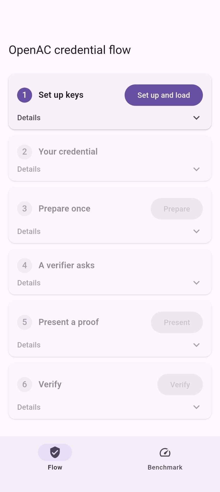
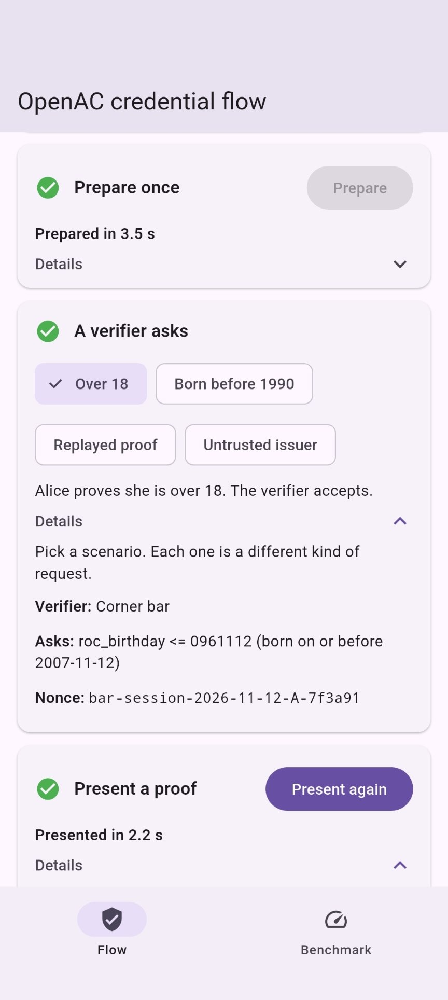
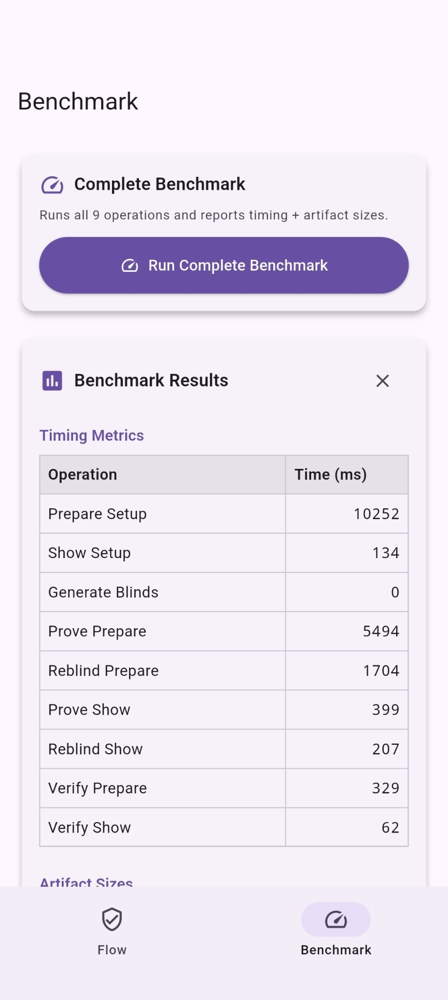

# OpenAC Mobile Wallet-Unit-PoC

Mobile App for [OpenAC Wallet-Unit-PoC](/wallet-unit-poc/ecdsa-spartan2/), support both Android and iOS through Flutter.

## Prerequisites

Before getting started, ensure you have the Flutter SDK installed:

1. Install Flutter SDK (3.47 or higher) from the [official Flutter installation guide](https://docs.flutter.dev/get-started/install)

2. Verify your installation:

    ```sh
    flutter doctor
    ```

> For more details, see [Mopro Prerequisites](https://zkmopro.org/docs/prerequisites)

## Getting Started

### 1. Install the Mopro CLI Tool

```sh
cargo install mopro-cli
```

### 2. iOS Configuration (iOS targets only)

Before building for iOS, configure Xcode and install Rust iOS targets.

1. **Install Xcode** from the App Store or [Apple Developer](https://developer.apple.com/xcode/)

2. **Configure Command Line Tools**: Open Xcode > Settings > Locations and verify the Command Line Tools path is set

3. **Install Rust iOS Targets**:

    ```bash
    # For iOS device (arm64)
    rustup target add aarch64-apple-ios

    # For iOS simulator (arm64, Apple Silicon)
    rustup target add aarch64-apple-ios-sim
    ```

> **Note**: x86_64 iOS simulator is not supported. See [Notes](#note) section for details.

> For more details, see [Mopro Prerequisites - iOS](https://zkmopro.org/docs/prerequisites#ios)

### 3. Android Configuration (Android targets only)

Before building for Android, install Android Studio and configure the NDK environment. The Rust FFI bindings require NDK for cross-compilation.

1. **Install Android Studio** from [developer.android.com/studio](https://developer.android.com/studio)

2. **Install JDK 17 or higher**: Android Studio's bundled JDK works. Otherwise download from [Oracle](https://www.oracle.com/java/technologies/downloads/) or use your package manager

3. **Install NDK 27.0.12077973** via Android Studio: `SDK Manager > SDK Tools > NDK (Side by Side)`

4. **Install Rust Android Targets**:

    ```bash
    rustup target add aarch64-linux-android armv7-linux-androideabi x86_64-linux-android i686-linux-android
    ```

5. **Set environment variables** in your shell config (`~/.zshrc` or `~/.bashrc`):

    ```bash
    # Android SDK
    export ANDROID_HOME="$HOME/Library/Android/sdk"

    # Find your NDK version
    ls $ANDROID_HOME/ndk  # e.g., 27.0.12077973

    # Set NDK path (replace version with yours)
    export NDK_PATH="$ANDROID_HOME/ndk/27.0.12077973"
    ```

6. Reload your shell or run `source ~/.zshrc`

> For more details, see [Mopro Prerequisites - Android Configuration](https://zkmopro.org/docs/prerequisites#android-configuration)

### 4. Flutter App

#### 4(a). Generate Flutter Bindings

These's already default [Flutter bindings](/wallet-unit-poc/mobile/mopro_flutter_bindings/), so no need to manually generate a new one.

However, if you want to play around with your own tweak version, see [Mopro Flutter Setup](https://zkmopro.org/docs/setup/flutter-setup) for generating a custom bindings.

#### 4(b). Connect Devices or Run Emulators

```sh
# Check Available Devices
flutter devices

# Start iOS Simulator or Android Emulator
flutter emulator --launch <EMULATOR_TYPE>
```

#### 4(c). Prepare Assets

The circuit assets and flow fixtures are generated locally from the circuits and never committed. Run this before the first build and after the circuits change:

```sh
bash scripts/prepare-assets.sh
```

It needs circom 2.2.3, Node.js with npm, yarn v1 and `shasum`. It recompiles the circuits when the build is missing or out of date, so the first run compiles the 2k circuit, which takes a few minutes and several GB of disk.

#### 4(d). Run Flutter with Release Mode

The app has two screens: Flow, a full OpenAC walk-through (prepare, present, verify), and Benchmark.

```sh
cd flutter
flutter run --release
```

## Screenshots

Pixel 10 Pro, release build.

| Flow, before setup | Flow, after Present | Benchmark results |
|:---:|:---:|:---:|
|  |  |  |

## Timing Measurements (Mobile)

All timing measurements are in milliseconds (ms).

**Test Device:** 
- iOS: iPhone 17, A19 chip, 8GB RAM
- Android: Pixel 10 Pro, Tensor G5, 16GB of RAM

### Prepare Circuit Timing

- Payload Size: 1920 Bytes
- Peak Memory Usage for Proving: 2.27 GiB

|    Device    | Setup (ms) | Prove (ms) | Reblind (ms) | Verify (ms) |
|:------------:|:----------:|:----------:|:------------:|:-----------:|
|  iPhone 17   |    3254    |    2102    |     884      |     137     |
| Pixel 10 Pro |    9282    |    5161    |     1732     |     318     |


### Show Circuit Timing

The Show circuit has constant performance regardless of JWT payload size.
- Peak Memory Usage for Proving: 1.96 GiB

|    Device    | Setup (ms) | Prove (ms) | Reblind (ms) | Verify (ms) |
|:------------:|:----------:|:----------:|:------------:|:-----------:|
|  iPhone 17   |     43     |     85     |      30      |     13      |
| Pixel 10 Pro |     99     |    308     |     130      |     65      |

## Note

### Excluded x86_64 iOS simulator in `mopro_flutter_bindings/ios/mopro_flutter_bindings.podspec`

```podspec
# Flutter.framework does not contain a i386 slice.
# exclude x86_64 since w2c2 is not supported on x86_64-ios simulator build
'EXCLUDED_ARCHS[sdk=iphonesimulator*]' => 'i386 x86_64',
```
